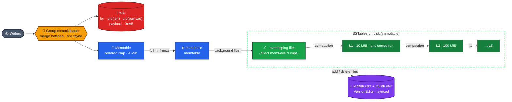
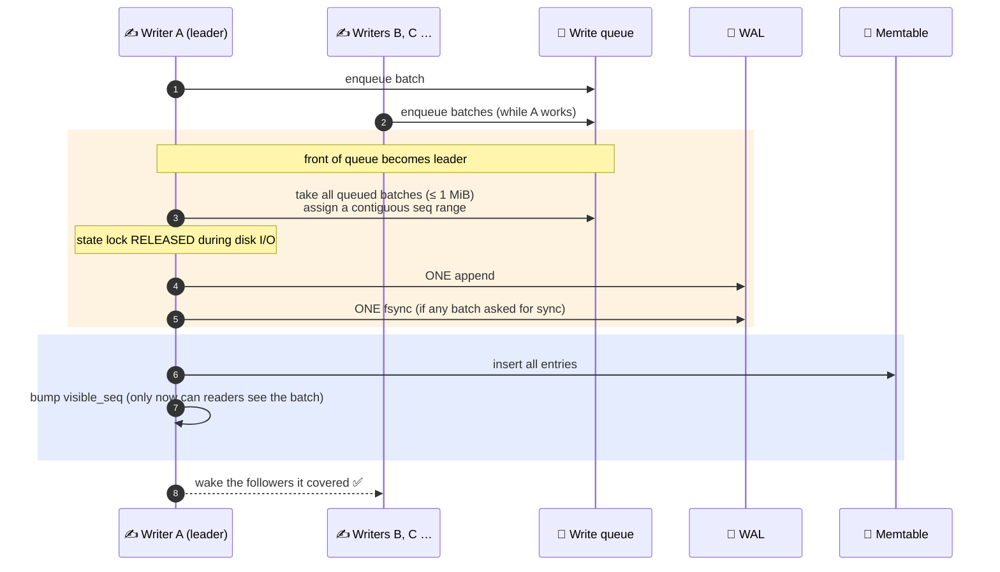
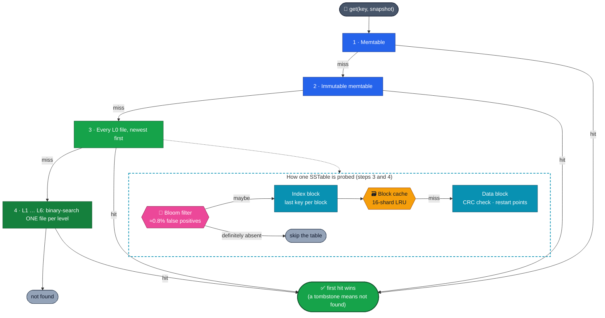
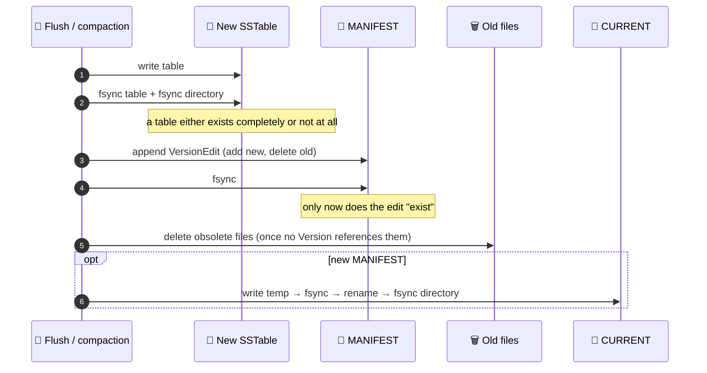
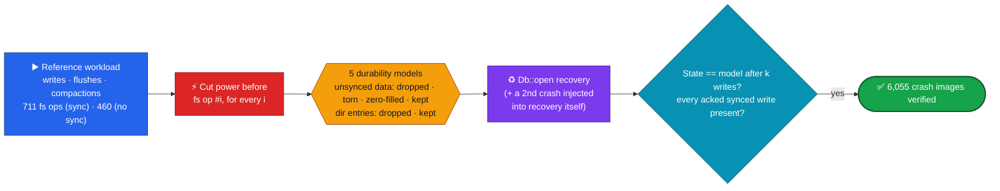
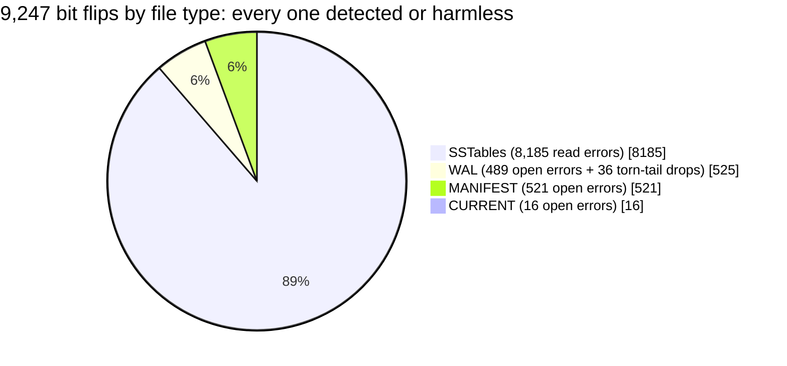
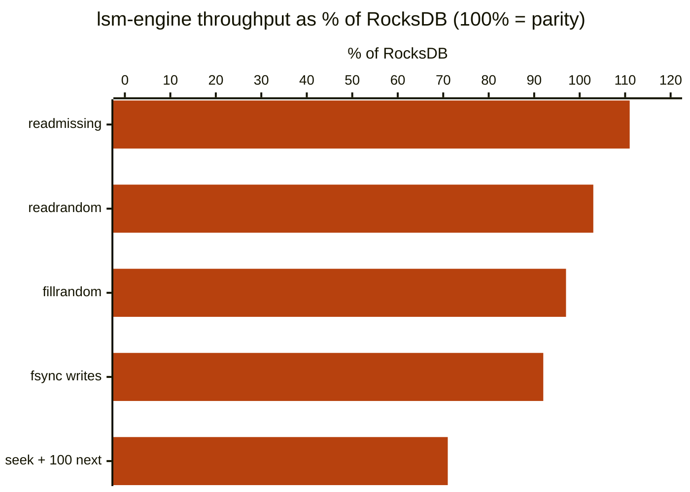

<div align="center">

# 🌲 LSM Engine

### An LSM-tree storage engine in Rust, written from scratch and crash-tested at every file-system operation

**WAL → memtable → L0 SSTables → leveled compaction · MVCC snapshots · group commit · bloom filters · sharded block cache · C API**

<br/>


[](https://github.com/siddhaantxsingh/LSM_ENGINE/actions/workflows/ci.yml)


[**Architecture**](#%EF%B8%8F-architecture) · [**Write path**](#%EF%B8%8F-write-path-wal-first-group-commit) · [**Read path**](#-read-path) · [**Crash safety**](#-crash-safety) · [**Testing**](#-how-its-tested) · [**Benchmarks**](#-benchmarks-vs-rocksdb-sled-btreemap) · [**Quick start**](#-quick-start)

</div>

---

## 📌 TL;DR

LSM trees power RocksDB, Cassandra, CockroachDB and TiKV. They turn random writes into **sequential I/O** by logging, buffering in memory, and reorganising data into sorted immutable files in the background. This is a from-scratch implementation of that design, focused on the part that's hard to get right: **never losing or corrupting acknowledged data.**

| | |
|---|---|
| 🧱 **Engine** | Internal keys with sequence numbers · tombstones · prefix-compressed 4 KiB blocks with restart points · per-block CRC32 · bloom filters (10 bits/key, double hashing) · 16-shard LRU block cache |
| ✍️ **Writes** | WAL first, then memtable · **group commit** (one fsync for a whole queue of writers) · batches atomic on disk *and* to readers · L0 write stalls for backpressure |
| 🔀 **Compaction** | Leveled (10× fan-out, L0–L6), score-based picking with a rotating compact pointer, snapshot-aware version dropping, **trivial moves**, output cut only at user-key boundaries |
| 🕰️ **MVCC** | Near-free snapshots (a sequence number + registration), honoured by every read, scan and compaction |
| 💥 **Verified by** | Power-loss simulation before **every** file-system op under 5 durability models · 9,247 bit flips in every file type · proptest against a `BTreeMap` model · SIGKILL tests · mutation testing |
| 🔌 **C API** | `capi/include/lsm.h`: NULL/length checks, explicit ownership, Rust panics caught at the boundary; tested under ASan+UBSan, valgrind and Miri |

---

## 🏗️ Architecture



<details>
<summary><b>📦 Module map</b></summary>

<br/>

| File | Responsibility |
|---|---|
| [`db.rs`](lsm-engine/src/db.rs) | Write path, group commit, reads, snapshots, background work, recovery |
| [`key.rs`](lsm-engine/src/key.rs) | Internal keys: `user_key ++ (seq << 8 \| kind)`, ordered by key ↑ then seq ↓ |
| [`memtable.rs`](lsm-engine/src/memtable.rs) | In-memory ordered table |
| [`log.rs`](lsm-engine/src/log.rs) | Record format shared by WAL and MANIFEST, plus recovery modes |
| [`block.rs`](lsm-engine/src/block.rs) · [`sstable.rs`](lsm-engine/src/sstable.rs) | Prefix-compressed blocks, index, footer, bounds-checked readers |
| [`bloom.rs`](lsm-engine/src/bloom.rs) | Bloom filter with Kirsch–Mitzenmacher double hashing |
| [`cache.rs`](lsm-engine/src/cache.rs) | Sharded LRU block cache, bounded in bytes |
| [`version.rs`](lsm-engine/src/version.rs) | Immutable `Version`s, `VersionEdit`s, MANIFEST replay, ref-counted file lifetime |
| [`compaction.rs`](lsm-engine/src/compaction.rs) | Picking, merging, tombstone and version dropping, trivial moves |
| [`iterator.rs`](lsm-engine/src/iterator.rs) | Merging, level and MVCC iterators |
| [`fs.rs`](lsm-engine/src/fs.rs) | **`FileSystem` trait: `StdFs` (real) and `SimFs` (power-loss simulator)** |

</details>

---

## ✍️ Write path: WAL first, group commit



- A **non-sync leader never absorbs a sync writer**; otherwise that writer would return before its data was fsynced.
- `visible_seq` advances **after** the memtable insert, so readers never see half a batch.
- **Backpressure:** at 8 L0 files each write is delayed 1 ms; at 12, writes stop until compaction catches up (same idea as RocksDB write stalls).

---

## 🔎 Read path



The lock is held only for microseconds, to grab references to the memtables, the current `Version` and a sequence number. The search itself runs lock-free. **Scans** use a merging iterator over every source, with lazily-opened per-level iterators and an MVCC layer that hides newer versions and tombstoned keys. Scan items are `Result`s, so a read error can never pass for "end of data".

---

## 🔒 Crash safety

Every metadata change is a `VersionEdit` appended to the MANIFEST. The ordering rules are what make a crash at *any* moment recoverable:



**Recovery (`Db::open`)** replays the MANIFEST and **refuses to open** on any damage other than a torn last record. That includes an empty MANIFEST, an incoherent history, or a live table that is missing or the wrong size. Nothing is deleted until the MANIFEST checks out, and tables orphaned by a dropped torn record are renamed `*.sst.lost` rather than deleted. WAL replay supports three modes: `TolerateCorruptedTail` (default), `AbsoluteConsistency` and `PointInTime`.

---

## 🧪 How it's tested

All file I/O goes through a `FileSystem` trait. In tests it is backed by **`SimFs`, an in-memory file system that models strict POSIX durability and can "lose power" before any operation.**



| Suite | What it proves |
|---|---|
| 💥 [`crash_sim.rs`](lsm-engine/tests/crash_sim.rs) | Power loss before **every** create / append / fsync / rename / remove / dir-fsync, under 5 durability models, including a crash *during recovery*. **6,055 crash images**, all equal to the model |
| ⚡ [`corruption.rs`](lsm-engine/tests/corruption.rs) | **9,247 single-bit flips** across SST, WAL, MANIFEST and CURRENT. Every outcome is an error or correct data; **never a wrong value, a silently missing key or a silently short scan** |
| 🎲 [`model.rs`](lsm-engine/tests/model.rs) | proptest against a `BTreeMap`: puts, deletes, batches, gets, range scans, **snapshot reads and scans**, flush, compaction, reopen |
| 🪓 [`crash.rs`](lsm-engine/tests/crash.rs) | SIGKILL a real process mid-write, flush and compaction, 5 rounds |
| 🐞 [`regressions.rs`](lsm-engine/tests/regressions.rs) | One **failing-first** test per audit defect |
| 🧬 [`mutation_check.sh`](scripts/mutation_check.sh) | Injects 14 known bugs; **11 caught** (the 3 survivors are analysed in the audit) |
| 🔌 [`capi/`](capi) | C test program under **ASan + UBSan** and **valgrind** (0 errors, 0 leaks); Rust FFI tests under **Miri** |



<sub>The 36 WAL cases are bit flips in the payload of the very last record. They can't be told apart from a torn write, so the default mode drops that record; <code>AbsoluteConsistency</code> reports them instead. This is documented and tested.</sub>

---

## 🐞 Bugs found and fixed

An audit using these tests found real data-loss bugs. Each fix landed with a test that **failed before the fix** ([`failing_first.log`](docs/evidence/2026-10-14/failing_first.log)):

| ID | Severity | What went wrong |
|:---:|:---:|---|
| D1 | 🔴 Critical | `flush()` froze the memtable while a write leader was still inserting. **340–978 acknowledged writes lost per run, with no crash at all** |
| D2 | 🔴 Critical | A corrupt mid-MANIFEST record ended replay silently, and the engine then **deleted live tables** as "unreferenced" |
| D11 | 🟠 High | *Found by the new corruption sweep:* a bit flip in the last MANIFEST record looked like a torn write, so **a committed edit vanished** → records now end with a non-zero trailer byte |
| D3 | 🟠 High | Mid-WAL corruption silently dropped every later synced write → the length field now has its own CRC |
| D4 | 🟠 High | Trusted SST footer sizes → integer overflow panic / huge allocation |
| D5, D6 | 🟠 High | Unopenable L0 tables were skipped, and scan errors looked like end-of-data → **silently short scans** |
| D7 | 🟠 High | No directory fsync after creating files → after power loss the MANIFEST could name a missing table |
| D8–D10 | 🟡 Medium | MANIFEST decode panics · missing tables only noticed on read · zero-filled WAL tail rejected |

Full audit: [`docs/AUDIT_2026-10-14.md`](docs/AUDIT_2026-10-14.md) · Requirements matrix: [`docs/REQUIREMENTS_MATRIX.md`](docs/REQUIREMENTS_MATRIX.md)

---

## 📊 Benchmarks vs RocksDB, sled, BTreeMap

[`bench-compare`](bench-compare): 300,000 random 16-byte keys, 100-byte values, single thread, no compression, bloom 10 bits/key, **RocksDB 10.4.2 with options matched to this engine's sizes**. Median of 3 runs.

| | **lsm-engine** | RocksDB 10.4.2 | sled 0.34 | BTreeMap (in-memory) |
|---|:---:|:---:|:---:|:---:|
| fillrandom (ops/s) | **141k** | 145k | 120k | 820k |
| readrandom (ops/s) | **361k** | 350k | 442k | 1.34M |
| readmissing (ops/s) | **2.19M** | 1.98M | 1.16M | 4.16M |
| seek + 100 × next (scans/s) | **37k** | 52k | 18k | 433k |
| fsync per write (ops/s) | **278** | 302 | *n/c* | — |
| write amplification | **4.0×** | 3.9–4.1× | 2.9–3.3× | — |
| disk size after compaction | **21 MB** | 21 MB | 62 MB | — |



> [!NOTE]
> The data set is small (35 MB, mostly cached) and the machine was a shared 4-vCPU container under load, with up to about 2× run-to-run variance. Treat these as rough same-machine comparisons, not capacity claims. Scans trail RocksDB because each memtable iterator currently copies the memtable. sled's synced-write numbers suggested `flush()` didn't always reach disk, so they're marked not comparable (*n/c*). Raw log: [`bench_compare.log`](docs/evidence/2026-10-14/bench_compare.log)

---

## 🚀 Quick start

```bash
cd lsm-engine
cargo test --release

cargo run --release --bin lsmctl -- /tmp/db put hello world
cargo run --release --bin lsmctl -- /tmp/db get hello
cargo run --release --bin lsmctl -- /tmp/db scan
cargo run --release --bin lsmctl -- /tmp/db stats
```

**As a library.** Scans return `Result` items, so an incomplete scan can't be mistaken for a complete one:

```rust
for item in db.scan(Some(b"a"), Some(b"z"), ReadOptions::default()) {
    let (k, v) = item?;
}
```

<details>
<summary><b>🔌 C API</b></summary>

<br/>

```c
#include "lsm.h"

lsm_db *db; char *err = NULL;
if (lsm_open("/tmp/db", /*sync=*/1, &db, &err) != 0) { /* report err, lsm_free_string(err) */ }
lsm_put(db, (const uint8_t *)"k", 1, (const uint8_t *)"v", 1, &err);
/* also: lsm_get / lsm_delete / lsm_batch_* / lsm_snapshot_* / lsm_iter_* / lsm_flush / lsm_compact */
lsm_close(db);
```

```bash
cd capi && ./run_c_tests.sh     # plain, ASan+UBSan, valgrind
```

Full header: [`capi/include/lsm.h`](capi/include/lsm.h)

</details>

**CI** ([`ci.yml`](.github/workflows/ci.yml)): `fmt` + `clippy -D warnings` → release tests → C API under ASan/UBSan + valgrind → Miri.

---

## ⚠️ Limitations

This is a learning and portfolio engine with a serious test suite. **It isn't production-ready.**

- **Never tested on real power loss or real disk faults.** `SimFs` models strict POSIX durability, but it isn't a real power cut.
- **No compression**, one background thread (flushes can wait behind compactions), no bounded table cache, no range deletes, no column families.
- Memtable is a `BTreeMap` behind an `RwLock`, not a lock-free skiplist, and memtable iterators copy it.
- **No coverage-guided fuzzing** yet. The mutation run had 3 survivors and wasn't repeated after a script fix.
- The on-disk log format changed during the audit, so databases from before it can't be opened.

---

## 📁 Repository layout

```text
LSM_ENGINE/
├── lsm-engine/          🌲 the engine crate + lsmctl CLI
│   ├── src/             db · key · memtable · log · block · sstable · bloom · cache · version · compaction · iterator · fs
│   ├── tests/           crash_sim · corruption · model · crash · regressions · db
│   └── DESIGN.md        🧠 design notes and trade-offs (LSM vs B-tree, amplification, compaction rules)
├── capi/                🔌 C ABI: include/lsm.h, cdylib/staticlib, C test program
├── bench-compare/       📊 vs RocksDB, sled, BTreeMap (not built by CI)
├── scripts/             🧬 mutation_check.sh
└── docs/                📖 audit, requirements matrix, evidence logs
```

Deep dive: [`lsm-engine/DESIGN.md`](lsm-engine/DESIGN.md), covering why LSM over a B-tree, the three amplification factors, compaction's snapshot rules, and the trivial-move bug that was avoided.

---

<div align="center">

**A storage engine is only as good as its worst crash.**

<br/>

Built by **[Siddhant Singh](https://github.com/siddhaantxsingh)** · <sub>MIT License</sub>

</div>
