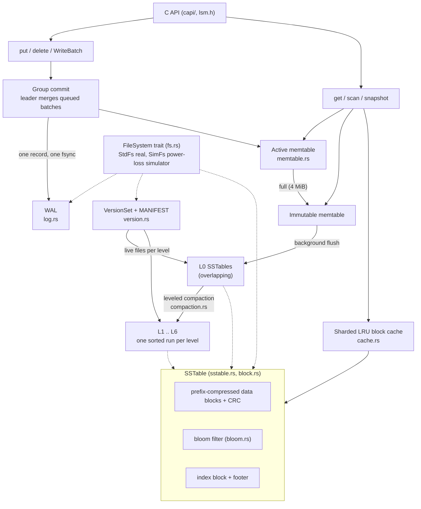

# LSM Engine

An LSM-tree key-value storage engine written from scratch in Rust, with a C API: WAL, memtable, leveled compaction, MVCC snapshots, group commit, bloom filters and a sharded block cache.

[](https://github.com/siddhaantxsingh/LSM_ENGINE/actions/workflows/ci.yml?query=branch%3Accr-a6e6c567-y4w7k8)

[](lsm-engine/LICENSE)

A learning and portfolio project with a serious test suite, not a production database. Every number below has a log in [`docs/evidence/2026-10-14/`](docs/evidence/2026-10-14/).

## Highlights

- **Crash consistency checked at every file-system operation.** A simulated file system (`SimFs`) cuts power before each create, append, fsync, rename, remove and directory fsync of a workload with flushes and compactions, under 5 durability modes, including a second crash during recovery: 6,055 crash images, all recovered to the model ([`crash_sweep.log`](docs/evidence/2026-10-14/crash_sweep.log)).
- **Corruption is never silent.** 9,247 single-bit flips across SST, WAL, MANIFEST and CURRENT files: every one gave an error, never a wrong value or a silently short scan. The one documented exception is a flip in the last WAL record, which looks like a torn write ([`corruption_sweep.log`](docs/evidence/2026-10-14/corruption_sweep.log)).
- **11 engine defects found and fixed with failing-first tests (D1–D11),** including a race in `flush()` that lost 340–978 acknowledged writes per run without any crash, and a MANIFEST bug that deleted live tables ([audit](docs/AUDIT_2026-10-14.md), [`failing_first.log`](docs/evidence/2026-10-14/failing_first.log)).
- **Model-based testing.** proptest compares puts, deletes, batches, gets, range scans, snapshot reads, flush, compaction and reopen against a `BTreeMap` (64 cases x up to 300 ops).
- **A C API that does not crash its caller.** NULL and length checks, explicit ownership, and `catch_unwind` on every entry point. The C test program runs plain, under ASan+UBSan and under valgrind (0 errors, 0 leaks); the Rust side runs under Miri ([`capi_tests.log`](docs/evidence/2026-10-14/capi_tests.log)).
- **Same-machine comparison with RocksDB.** On a 300k-key random workload the engine is within the run-to-run noise of RocksDB 10.4.2 for random writes and point reads, with similar write amplification (4.0x vs 3.9–4.1x). See [Benchmarks](#benchmarks) for the conditions.

## Architecture



Writers join a queue; the front writer becomes the group-commit leader, writes one WAL record and does one fsync for the whole group, then inserts into the memtable. A sequence number is made visible only after the memtable insert, so readers never see half a batch. Full memtables are flushed to overlapping L0 tables by one background thread, and leveled compaction merges them into non-overlapping levels, keeping any version a live snapshot can still see. Every flush or compaction is recorded as a `VersionEdit` in the MANIFEST, fsynced only after the new tables are fsynced. All file I/O goes through a `FileSystem` trait, which is what lets the crash tests swap in `SimFs`. Details: [`DESIGN.md`](lsm-engine/DESIGN.md).

## Quick start

Requires a recent stable Rust toolchain (edition 2024).

```bash
git clone https://github.com/siddhaantxsingh/LSM_ENGINE.git
cd LSM_ENGINE/lsm-engine

cargo test --release            # all crate tests, including the crash and corruption sweeps

cargo run --release --bin lsmctl -- /tmp/db put hello world
cargo run --release --bin lsmctl -- /tmp/db get hello
cargo run --release --bin lsmctl -- /tmp/db scan
cargo run --release --bin lsmctl -- /tmp/db stats
```

C API tests (needs `clang` and `valgrind`):

```bash
cd ../capi
cargo test --release
./run_c_tests.sh                # plain, ASan+UBSan, valgrind
```

Using the Rust API. Scans yield `Result` items, so a read error that stops a scan early shows up as a final `Err` and is never mistaken for the end of the data:

```rust
use lsm_engine::{Db, Options, ReadOptions};

let db = Db::open("/tmp/db", Options::default())?;
db.put(b"hello", b"world")?;
for item in db.scan(Some(b"a"), Some(b"z"), ReadOptions::default()) {
    let (k, v) = item?;
}
```

## Benchmarks

`bench-compare`: 300,000 random 16-byte keys, 100-byte values (about 33 MB of puts), single thread, no compression, bloom filter 10 bits/key. Median of 3 runs on a shared 4-vCPU container at load average 8–11 from other jobs.

| | lsm-engine | RocksDB 10.4.2 | sled 0.34 | BTreeMap (memory) |
|---|---:|---:|---:|---:|
| fillrandom (ops/s) | 141k | 145k | 120k | 820k |
| readrandom (ops/s) | 361k | 350k | 442k | 1.34M |
| readmissing (ops/s) | 2.19M | 1.98M | 1.16M | 4.16M |
| seek + 100 next (scans/s) | 37k | 52k | 18k | 433k |
| fsync per write (ops/s) | 278 | 302 | see note | – |
| disk bytes written / user bytes | 4.0x | 3.9–4.1x | 2.9–3.3x | – |
| disk size after compaction | 21 MB | 21 MB | 62 MB | – |

Read these as rough same-machine comparisons: single runs vary up to about 2x. The data set is small and mostly cached, so it says nothing about large data. sled's synced-write results (298–9,669 ops/s) suggest `flush()` did not always reach the disk, so they are not comparable. RocksDB ran with near-default options matched to this engine's sizes. Full log: [`bench_compare.log`](docs/evidence/2026-10-14/bench_compare.log); how to rerun on an idle machine: [`OWNER_ACTIONS.md`](docs/OWNER_ACTIONS.md#5-benchmarks-on-dedicated-hardware-optional).

## How correctness is verified

| Test | What it checks |
|---|---|
| [`tests/crash_sim.rs`](lsm-engine/tests/crash_sim.rs) | Power loss before every fs operation (711 ops with sync, 460 without) x 5 durability modes (unsynced data dropped / torn / zero-filled / kept; directory entries dropped / kept). Recovery must match the model, with every acknowledged synced write present. Also crashes during recovery. 6,055 images. |
| [`tests/corruption.rs`](lsm-engine/tests/corruption.rs) | 9,247 bit flips: 8,185 in SSTs (all read errors), 521 in the MANIFEST and 16 in CURRENT (all open errors), 525 in WALs (489 open errors, 36 treated as a torn last record). |
| [`tests/model.rs`](lsm-engine/tests/model.rs) | proptest against a `BTreeMap` model, including snapshots, compaction and reopen. |
| [`tests/regressions.rs`](lsm-engine/tests/regressions.rs) | One failing-first test per audit defect (D1–D10). |
| [`tests/crash.rs`](lsm-engine/tests/crash.rs) | SIGKILL of a real process mid-write, flush and compaction, 5 rounds. |
| [`capi/`](capi/) | C program under ASan+UBSan and valgrind; Rust FFI tests under Miri. |
| [`scripts/mutation_check.sh`](scripts/mutation_check.sh) | Injects 14 known bugs; 11 were caught. The 3 survivors are explained in the [audit](docs/AUDIT_2026-10-14.md#open-issues-and-limitations). |

The final run passed 41 tests across the crate's unit and integration targets ([`final_tests.log`](docs/evidence/2026-10-14/final_tests.log)). [CI](.github/workflows/ci.yml) runs four jobs on every push: `lint` (rustfmt, clippy `-D warnings`), `test` (`cargo test --release`), `capi` (C tests with ASan and valgrind) and `miri`.

## Recovery behaviour

- **MANIFEST.** A torn last record (crash during an append) is dropped. Any other damage, an empty MANIFEST, an incoherent history, or a live table that is missing or the wrong size makes `Db::open` fail. Nothing is deleted before the MANIFEST checks out; tables orphaned by a dropped torn record are renamed `*.sst.lost`.
- **WAL**, chosen with `WalRecoveryMode`:
  - `TolerateCorruptedTail` (default): drop a torn tail of the newest WAL that has data; anything else is an error.
  - `AbsoluteConsistency`: any damage is an error.
  - `PointInTime`: replay up to the first damage and ignore the rest (lightly tested).
- **Record format:** `len | crc(len) | crc(payload) | payload | 0xA5`; files start with the magic `LSMLOG\0\2`. The format changed in the 2026-10-14 audit, so older databases cannot be opened ([migration](docs/OWNER_ACTIONS.md#3-existing-databases-need-to-be-rebuilt-on-disk-format-change)).

## Design decisions

- **Leveled, not tiered, compaction.** Higher write amplification in exchange for low read and space amplification: one candidate file per level on a read.
- **Group commit with the lock released during I/O.** One fsync covers every queued writer, and readers are not blocked behind the disk. A non-sync leader never absorbs a sync writer.
- **Immutable versions with reference counting.** Iterators hold an `Arc<Version>`; files are deleted only when no version references them, so long scans need no explicit tracking.
- **A length checksum separate from the payload checksum.** Lets recovery tell a torn tail from mid-log damage, which fixed the silent WAL truncation (D3) and the dropped MANIFEST edit (D11).
- **All I/O behind a `FileSystem` trait.** Costs one indirection; makes power-loss simulation at every operation possible.

Full rationale: [`lsm-engine/DESIGN.md`](lsm-engine/DESIGN.md).

## Limitations and status

- **No real power-loss or disk-fault testing.** `SimFs` models strict POSIX durability in memory; it is not a real power cut. BLOCKED on hardware, see [`OWNER_ACTIONS.md`](docs/OWNER_ACTIONS.md).
- A bit flip in the payload of the very last WAL record looks like a torn write; the default mode drops that record (`AbsoluteConsistency` reports it).
- Mutation check: 3 of 14 mutants survived, and the run was not repeated after a script fix.
- No compression, one background thread, no bounded table cache, no range deletes, no coverage-guided fuzzing. Memtable iterators copy the memtable.
- Benchmarks come from a shared, noisy machine and a small data set.
- The on-disk format changed in the audit; databases from older versions must be exported and reloaded.

## Repository layout

```text
lsm-engine/        the engine crate and the lsmctl CLI
  src/             db, memtable, log (WAL), sstable, block, bloom, cache,
                   compaction, version (MANIFEST), fs (StdFs / SimFs)
  tests/           crash_sim, corruption, model, regressions, crash, db
capi/              C API: include/lsm.h, Rust cdylib/staticlib, C test program
bench-compare/     benchmark vs RocksDB, sled and BTreeMap (not built by CI)
scripts/           mutation_check.sh
docs/              audit, requirements matrix, owner actions, evidence logs
```

## Documentation

| Topic | Link |
|---|---|
| Design notes | [`lsm-engine/DESIGN.md`](lsm-engine/DESIGN.md) |
| Audit, defects and scorecard (2026-10-14) | [`docs/AUDIT_2026-10-14.md`](docs/AUDIT_2026-10-14.md) |
| Requirements matrix | [`docs/REQUIREMENTS_MATRIX.md`](docs/REQUIREMENTS_MATRIX.md) |
| Owner actions (merge, migration, benchmarks, power-loss testing) | [`docs/OWNER_ACTIONS.md`](docs/OWNER_ACTIONS.md) |
| Evidence logs | [`docs/evidence/2026-10-14/`](docs/evidence/2026-10-14/) |
| C header | [`capi/include/lsm.h`](capi/include/lsm.h) |

---

Built by [Siddhant Singh](https://github.com/siddhaantxsingh). Licensed under the [MIT License](lsm-engine/LICENSE).
